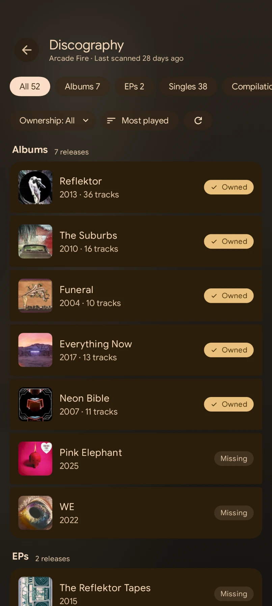
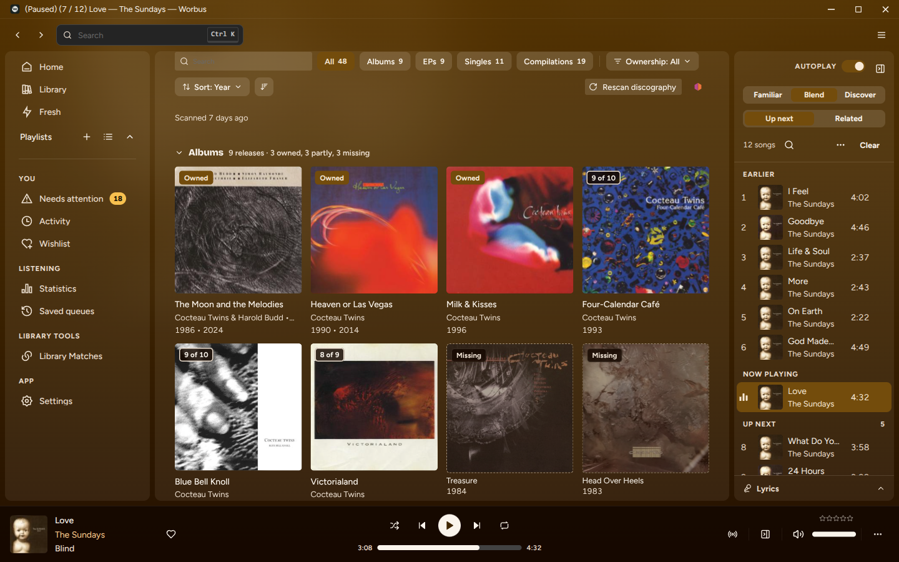
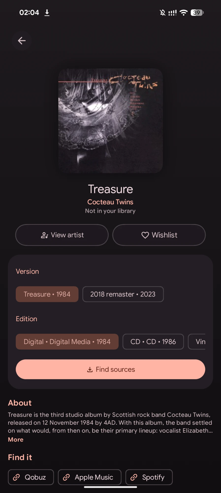
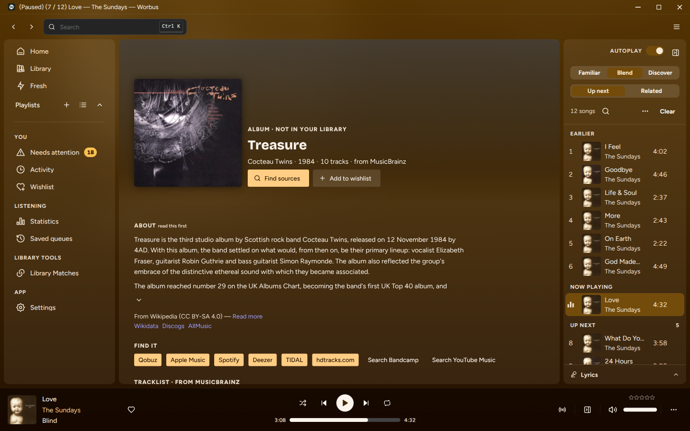
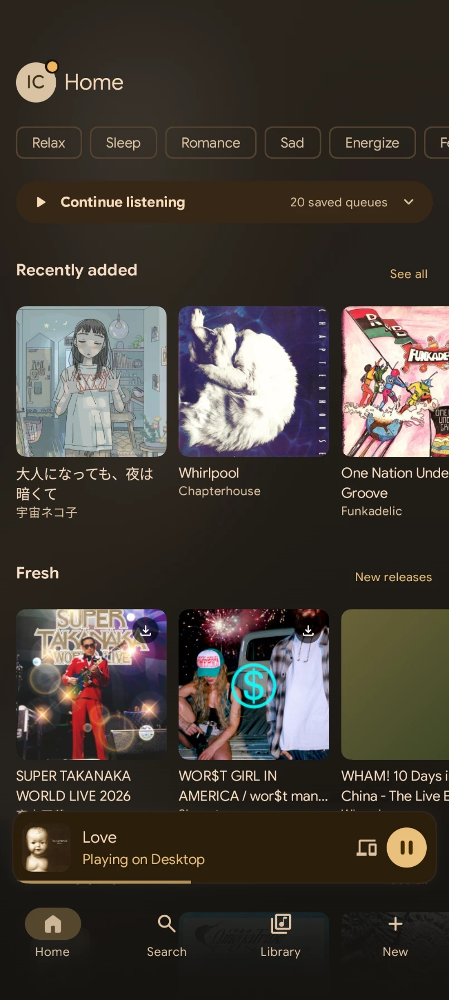
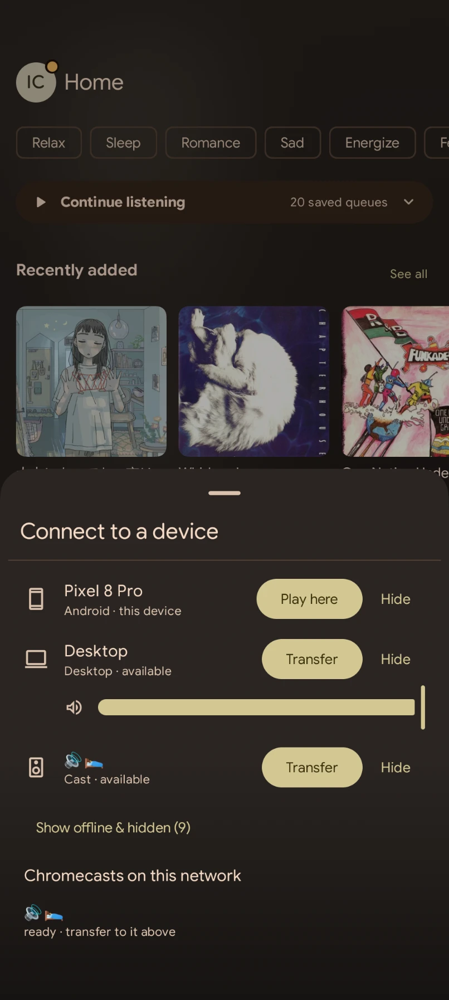
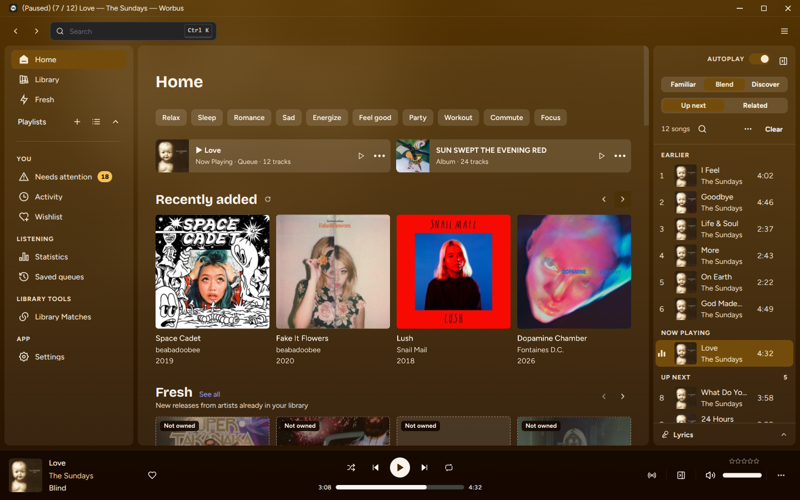
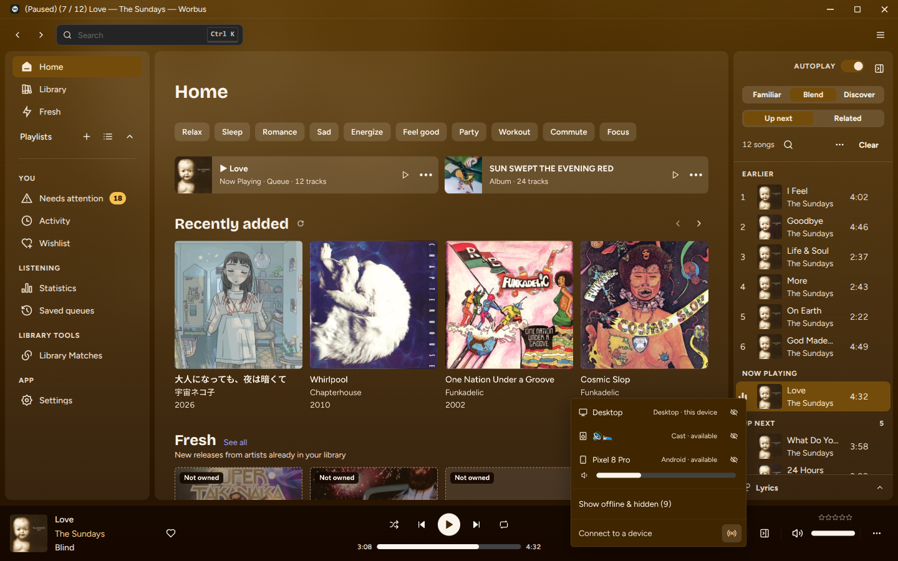

<picture>
  <source media="(prefers-color-scheme: dark)" srcset="docs/brand/worbus-dark.svg">
  
</picture>

# Worbus

**Your music library, finished and shared.** Worbus joins two self-hosted projects into one:
a Spotify-Connect–style **shared playback session** across every device, and **lb-bot**, which
shows every album your library is missing, and where to find it — from inside the player, on the artist page
you're already looking at.

It sits on top of [Navidrome](https://navidrome.org) and needs nothing hosted by anyone else.
Worbus is not affiliated with Navidrome.

Worbus is three pieces that work together:

- **Worbus for Android**, the phone app.
- **Worbus for desktop**, the computer app (Linux, Windows, macOS).
- **Worbus Server**, one container that runs beside your Navidrome and ties the apps together.

### ▶ [**Install Worbus →**](INSTALL.md)

**If you want to run this, start there, not here.** One page: the Worbus Server (one container beside your
Navidrome, three settings), the apps, the first run, and how to send logs. Prebuilt apps need no
toolchain: **Worbus for Android** is on
[worbus-android's Releases](https://github.com/illuminator69/worbus-android/releases), and **Worbus for
desktop** is on [worbus-desktop's Releases](https://github.com/illuminator69/worbus-desktop/releases).
The [latest release](https://github.com/illuminator69/worbus/releases/latest) lists all three pieces with their
checksums. Bugs and ideas for any piece go to [this repository's issues](https://github.com/illuminator69/worbus/issues/new/choose).

---

## What you get

### The missing half of your library, visible

Open an artist and the albums you *don't* have sit right there among the ones you do, marked as missing,
a partly-owned album carrying its missing count. Nothing is a separate "wanted" list; the gaps live where
you'd notice them. The same page on the phone and on the desktop:

<p align="center">
  
  
</p>

**A missing album opens as a page of its own**, with its tracklist, before anything is fetched. Check it
against the canonical MusicBrainz tracklist, choose a quality, and only then go looking for sources.

<p align="center">
  
  
</p>

### One session, every device

Home shows what to play next. The device picker lists every device, the phone, the desktop and the other
app among them, and any of them can take over the session mid-song.

<p align="center">
  
  
</p>
<p align="center">
  
  
</p>

Behind the gaps, lb-bot, the half that knows which albums are missing, handles the per-track gap filling:
which tracks are absent, which sources are ready, and what it is working on. It has its own page, served
by the Worbus Server.

### Everything else

- **One playback session, every device.** Control what's playing on one device from another; move
  playback mid-song to your desktop, your phone, or a Chromecast, and it resumes where it was. A
  play, pause, seek or volume change shows at once on the device you pressed it on.
- **Every device in one picker.** Each says what it is and how loud it is, and any one's volume can
  be set from its row, playing or not. The sleep timer belongs to the session, not to one device.
- **Stations that every device shares.** Radio and autoplay are computed by the hub, so a station
  started on the phone carries on unchanged when playback moves to the desktop. Skips and
  plays-through steer it, and no song repeats within it. Autoplay sits in the queue as four chips
  (Off, Close, Balanced, Explore); a tap changes the upcoming songs at once, on whichever device is
  playing.
- **Mixed for You, the same in both clients.** Radio around a song, Your mix (built from what you
  play most), a genre run, or more like one artist; plus Song Journey and text-to-music search.
- **Custom radio and moods.** A radio can start from up to eight artists, with a variety setting
  and a mood filter. Moods (Relax, Focus, Workout and others) are lists of your own songs that the
  hub ranks with AudioMuse-AI's text search. Worbus for Android shows them on Home as chips, each with four mixes,
  and offers mood chips in the queue.
- **lb-bot on the phone.** Worbus for Android has lb-bot's Needs attention, Source history, Listening stats and
  library tools in its avatar menu.
- **Discover and Listening.** Rows of fresh releases, ListenBrainz playlists, rediscoveries and
  similar artists, and a listening-history page mirrored from ListenBrainz.
- **Continue Listening across clients.** A shared, hub-owned queue history, so what you started on
  your phone is waiting on your desktop.

Both halves are optional and fail soft: no lb-bot means the discography surface simply isn't there;
without AudioMuse the stations run on Navidrome's similar songs alone, and without the hub each
client falls back to its own Auto DJ. The core remote-control layer needs neither.

---

## How it fits together

Inside those three pieces there are five parts, three of them optional:

| | |
|---|---|
| **Hub** | A headless relay that owns the *session intent* — queue, position, which device is active, the sleep timer — and never touches audio. It also computes the stations, and proxies AudioMuse, lb-bot and the preview sidecar so no device carries their credentials. Python and `websockets`, one file. Lives in this repo under `hub/`. |
| **Clients** | Every client is both a controller and a receiver. **Worbus for desktop** and **Worbus for Android** each connect over WebSocket and can play, or hand playback to someone else. |
| **AudioMuse-AI** | Optional. The recommendation engine behind the stations, the mixes and Song Journey. Reached through the hub, so no device carries its credentials. |
| **lb-bot** | Optional. Indexes each artist's full MusicBrainz discography, shows every album your library is missing, and where to find it, and can retag an album to a different release or merge two spellings of an artist. Also reached only through the hub. |
| **Preview sidecar** (currently not being developed) | Optional. Lets you hear a track the library doesn't have, in the ordinary queue. Its own process under `preview/`, because it is the one thing that serves *audio* — the hub proxies its control plane and never a byte of media. |

Read [`docs/ARCHITECTURE.md`](docs/ARCHITECTURE.md) for the whole design, and
[`PROTOCOL.md`](PROTOCOL.md) for the wire spec.

## Repositories

| Repo | What's in it |
|---|---|
| **[worbus](https://github.com/illuminator69/worbus)** (you are here) | The front door: the install page, the hub, the Worbus Server image (`server/`), the preview sidecar, the docs, and the one issue tracker. |
| **[worbus-android](https://github.com/illuminator69/worbus-android)** | Worbus for Android — a fork of [Navic](https://github.com/ssalggnikool/Navic) by paige, with its UI rebuilt around Worbus. Kept separate so upstream Navic releases can still be merged. Download and issues: see this repository. GPL-3.0. |
| **[worbus-desktop](https://github.com/illuminator69/worbus-desktop)** | Worbus for desktop — a fork of [Feishin](https://github.com/jeffvli/feishin) by Jeff Li. Separate for the same reason: flattening thousands of commits of upstream history into this tree would destroy the merge path. Download and issues: see this repository. GPL-3.0; this is also where the binaries' source lives. |
| **[lb-bot](https://github.com/illuminator69/lb-bot)** | The library-gap filler. An independent service with its own release cycle, useful on its own, and optional here. |

## Contents of this repo

```
INSTALL.md            how to install the server and the apps, and send logs
server/               the Worbus Server image — Dockerfile, launcher, healthcheck, compose.yaml, .env.example
hub/                  the relay — hub.py, Dockerfile, tools/ (it ships inside the Worbus Server image)
preview/              the preview sidecar — preview.py, Dockerfile, docker-compose.yml, tools/
docs/ARCHITECTURE.md  what each piece is, how they talk, and where the code lives
docs/brand/           the Worbus icon (light and dark) shown at the top of this file
docs/screenshots/0.6/ the screenshots shown in this file
PROTOCOL.md           the wire protocol spec
```

## Licence

The hub and the docs are this project's own work. Both clients are GPL-3.0 forks and carry their
upstream projects' licences — all credit for Navic belongs to
[paige](https://github.com/ssalggnikool), and for Feishin to
[jeffvli](https://github.com/jeffvli) and their contributors.

- Worbus for Android is a fork of [Navic](https://github.com/ssalggnikool/Navic) by paige.
- Worbus for desktop is a fork of [Feishin](https://github.com/jeffvli/feishin) by Jeff Li.
- Licensed GPL-3.0, like the original.
- Worbus is not affiliated with Navidrome.
