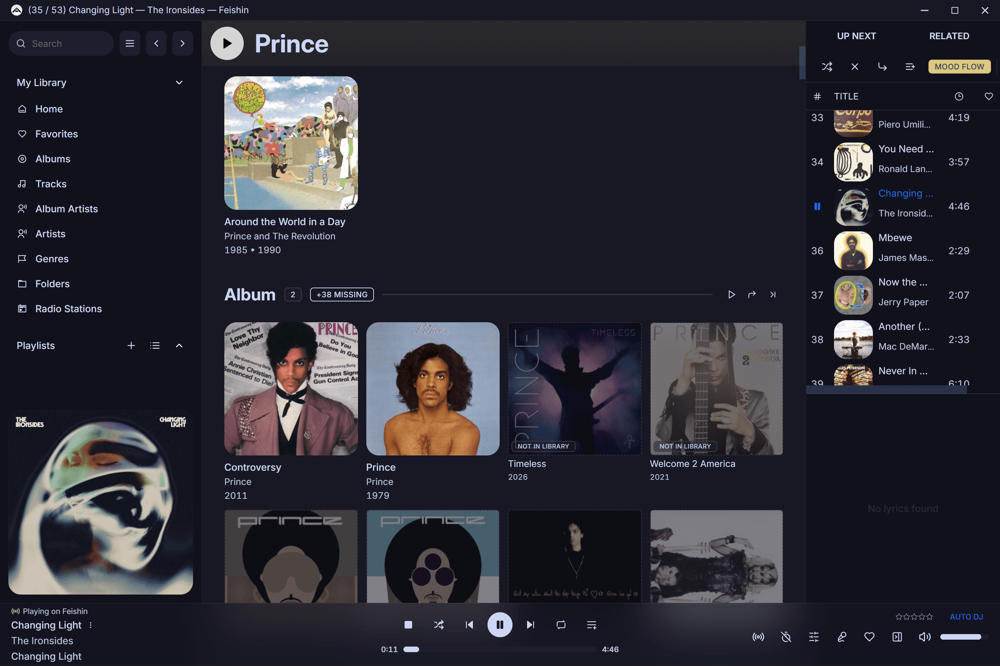
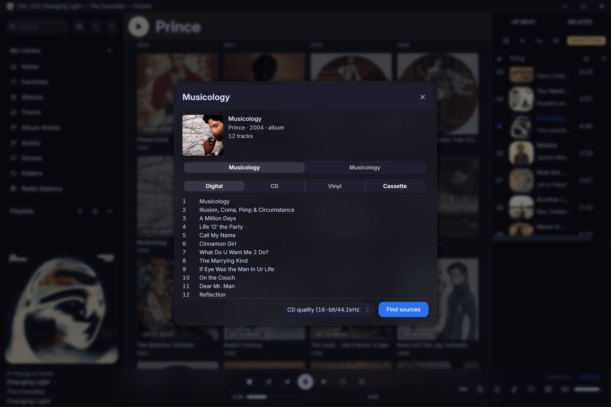
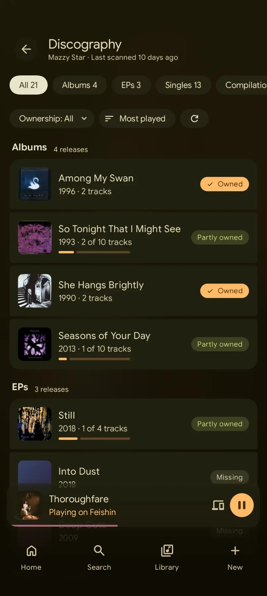
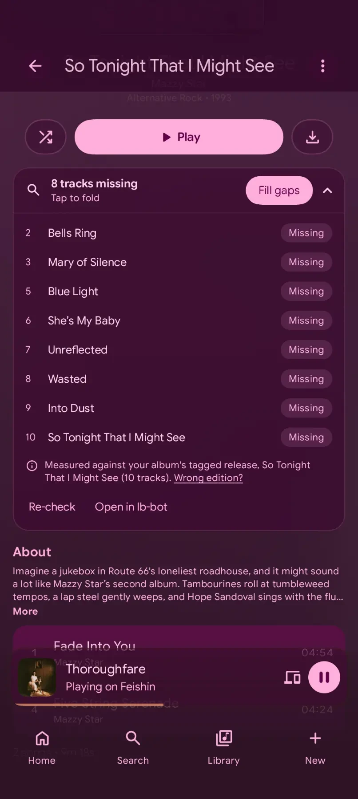
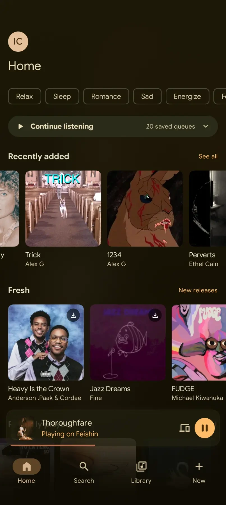

# navi-connect

**Your music library, finished and shared.** navi-connect joins two self-hosted projects into one:
a Spotify-Connect–style **shared playback session** across every device, and **lb-bot**, which knows
every album your library is missing and can fetch it — from inside the player, on the artist page
you're already looking at.

It sits on top of [Navidrome](https://navidrome.org) and needs nothing hosted by anyone else.

### ▶ [**Setup & testing guide →**](TESTING-SETUP.md)

**If you want to run this, start there, not here.** It covers prerequisites, step-by-step setup, a
smoke test that isolates failures, and every known bug and caveat. Prebuilt clients need no
toolchain: **Navic** for Android is on
[navic-gaps' Releases](https://github.com/illuminator69/navic-gaps/releases) (first alpha:
[v.0.1.0](https://github.com/illuminator69/navic-gaps/releases/tag/v.0.1.0)), and **Feishin** for
the desktop is on this repository's [Releases](../../releases).

---

## What you get

### The missing half of your library, visible

Open an artist and the albums you *don't* have sit right there among the ones you do — greyed out and
marked, a partly-owned album carrying its missing count. Nothing is a separate "wanted" list; the gaps
live where you'd notice them.

<p align="center">
  
</p>

**A download is reviewed, not fired blind.** Pick the edition, check it against the canonical
MusicBrainz tracklist, choose a quality, and only then go looking for sources.

<p align="center">
  
</p>

The same surface on Android — note the mini-player reading **Playing on Feishin**: the phone is
controlling a session running on the desktop. An artist's discography marks every release owned,
partly owned or missing, and a partly owned album says which tracks it lacks and fills them in one
tap.

<p align="center">
  
  
  
</p>

Navic's Home: mood chips, a pill that resumes any saved queue, and the newest additions.

<p align="center">
  
</p>

Behind it, lb-bot's own workspace handles the per-track gap filling — which tracks are absent, which
sources are ready, and what it's working on.

<p align="center">
  
</p>

### Everything else

- **One playback session, every device.** Control what's playing on one device from another; move
  playback mid-song to your desktop, your phone, or a Chromecast, and it resumes where it was. A
  play, pause, seek or volume change shows at once on the device you pressed it on.
- **Every device in one picker.** Each says what it is and how loud it is, and any one's volume can
  be set from its row, playing or not. The sleep timer belongs to the session, not to one device.
- **Stations that every device shares.** Radio and autoplay are computed by the hub, so a station
  started on the phone carries on unchanged when playback moves to the desktop. Skips and
  plays-through steer it, and no song repeats within it. Autoplay sits in the queue as four chips
  (Off, Close, Balanced, Explore); a tap changes the upcoming songs at once, on whichever device is
  playing.
- **Mixed for You, the same in both clients.** Radio around a song, Your mix (built from what you
  play most), a genre run, or more like one artist; plus Song Journey and text-to-music search.
- **Custom radio and moods.** A radio can start from up to eight artists, with a variety setting
  and a mood filter. Moods (Relax, Focus, Workout and others) are lists of your own songs that the
  hub ranks with AudioMuse-AI's text search. Navic shows them on Home as chips, each with four mixes,
  and offers mood chips in the queue.
- **lb-bot on the phone.** Navic has lb-bot's Needs attention, Source history, Listening stats and
  library tools in its avatar menu.
- **Discover and Listening.** Rows of fresh releases, ListenBrainz playlists, rediscoveries and
  similar artists, and a listening-history page mirrored from ListenBrainz.
- **Continue Listening across clients.** A shared, hub-owned queue history, so what you started on
  your phone is waiting on your desktop.

Both halves are optional and fail soft: no lb-bot means the discography surface simply isn't there;
without AudioMuse the stations run on Navidrome's similar songs alone, and without the hub each
client falls back to its own Auto DJ. The core remote-control layer needs neither.

---

## How it fits together

Four pieces, three of them optional:

| | |
|---|---|
| **Hub** | A headless relay that owns the *session intent* — queue, position, which device is active, the sleep timer — and never touches audio. It also computes the stations, and proxies AudioMuse, lb-bot and the preview sidecar so no device carries their credentials. Python and `websockets`, one file. Lives in this repo under `hub/`. |
| **Clients** | Every client is both a controller and a receiver. **Feishin** (desktop) and **Navic** (Android) each connect over WebSocket and can play, or hand playback to someone else. |
| **AudioMuse-AI** | Optional. The recommendation engine behind the stations, the mixes and Song Journey. Reached through the hub, so no device carries its credentials. |
| **lb-bot** | Optional. Indexes each artist's full MusicBrainz discography, knows what the library lacks, can acquire it, and can retag an album to a different release or merge two spellings of an artist. Also reached only through the hub. |
| **Preview sidecar** | Optional. Lets you hear a track the library doesn't have, in the ordinary queue. Its own process under `preview/`, because it is the one thing that serves *audio* — the hub proxies its control plane and never a byte of media. |

Read [`docs/ARCHITECTURE.md`](docs/ARCHITECTURE.md) for the whole design, and
[`PROTOCOL.md`](PROTOCOL.md) for the wire spec.

## Repositories

| Repo | What's in it |
|---|---|
| **[navi-connect](https://github.com/illuminator69/navi-connect)** (you are here) | The hub, the preview sidecar, the docs, and the [Feishin builds](../../releases). |
| **[navic-gaps](https://github.com/illuminator69/navic-gaps)** | The Android client — a fork of [ssalggnikool/Navic](https://github.com/ssalggnikool/Navic), with its UI rebuilt around navi-connect. Kept separate so upstream Navic releases can still be merged with `git merge v1.0.0-alphaNN`. Its APKs are on [its own Releases page](https://github.com/illuminator69/navic-gaps/releases). GPL-3.0. |
| **[feishin-gaps](https://github.com/illuminator69/feishin-gaps)** | The desktop client — a fork of [Feishin](https://github.com/jeffvli/feishin). Separate for the same reason: flattening thousands of commits of upstream history into this tree would destroy the merge path. GPL-3.0; this is also where the binaries' source lives. |
| **[lb-bot](https://github.com/illuminator69/lb-bot)** | The library-gap filler. An independent service with its own release cycle, useful on its own, and optional here. |

## Contents of this repo

```
hub/                  the relay — hub.py, Dockerfile, docker-compose.yml, tools/
preview/              the preview sidecar — preview.py, Dockerfile, docker-compose.yml, tools/
docs/ARCHITECTURE.md  what each piece is, how they talk, and where the code lives
docs/screenshots/     images used by this file
PROTOCOL.md           the wire protocol spec
TESTING-SETUP.md      prerequisites, setup, smoke test, known bugs and caveats
```

## Licence

The hub and the docs are this project's own work. Both clients are GPL-3.0 forks and carry their
upstream projects' licences — all credit for Navic belongs to
[paige](https://github.com/ssalggnikool), and for Feishin to
[jeffvli](https://github.com/jeffvli) and their contributors.
